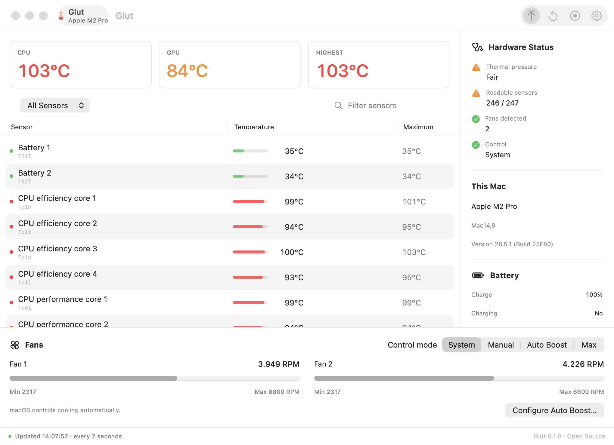

# Glut

**Temperatures, fans, and cooling rules for your Mac. Free and open source.**

Glut is a native macOS alternative to TG Pro, built with SwiftUI and IOKit. It reads real AppleSMC sensors, shows their current and highest temperatures, and provides administrator-authorized fan control. No accounts, subscriptions, telemetry, or third-party runtime dependencies.

> **Early release:** monitoring has been exercised on the developer's Apple Silicon Mac. Fan writes and recovery require hardware testing; Intel builds are cross-compiled, not hardware-validated. This release does **not** yet match TG Pro's full hardware coverage or diagnostics.



## Install

Requires **macOS 14 Sonoma or later**, Apple Silicon or Intel.

```sh
brew install --cask theitger/tap/glut
```

Or download `Glut-0.1.0.zip` from [Releases](https://github.com/theitger/glut/releases) and move `Glut.app` into Applications.

The initial release is **ad-hoc signed, not Apple-notarized**. macOS may require you to allow Glut in **System Settings → Privacy & Security → Open Anyway** after the first launch attempt. Homebrew does not remove quarantine or disable Gatekeeper.

## Features

- Live AppleSMC temperatures, grouped by component, with searchable sensor names and raw keys.
- CPU/GPU/highest-temperature summaries, per-sensor session maximums, and five-minute history.
- Menu bar temperature and a compact panel with fan speeds and control modes.
- System, Manual, Max, and temperature-triggered Auto Boost fan modes.
- Configurable rules: highest matching percentage wins; 3°C hysteresis prevents oscillation.
- Current/minimum/maximum fan RPM and hardware-bounded target speeds.
- macOS thermal pressure, sensor availability, and available battery information.
- Configurable local temperature notifications and CSV recording.
- Celsius/Fahrenheit display, menu bar sensor selection, and launch at login.

### Fan control

Monitoring runs without administrator rights. Selecting a custom control mode asks macOS for administrator authorization to start the bundled helper for that app session. The helper exposes only a bounded fan-control protocol through a local socket; no persistent privileged service is installed.

- The socket lives inside a root-owned temporary directory and accepts one connection from the authorized user. The app also verifies that its peer is root.
- The helper validates every request and reads the rule sensors itself.
- A percentage selects a point between each fan's hardware minimum and maximum: **0% means hardware minimum**. All fans use the same percentage of their own range.
- With no matching Auto Boost rule, control returns to macOS. Rules remain active until 3°C below their trigger.
- Missing enabled rule sensors, malformed commands, write failures, an app disconnect, or an eight-second heartbeat timeout trigger an attempted reset to system control.
- Sleeping the Mac ends custom control. After waking, choose a custom mode again to authorize a new session.
- The helper attempts every fan reset, retries failures, and records reset failures in the macOS unified log under `dev.theitger.glut`. Firmware can reject writes, including resets; recovery is an attempt, not a hardware guarantee.

Manual settings can reduce cooling relative to Apple's automatic curve. Use **System** to let macOS manage cooling. Do not run multiple fan-control utilities at once.

### Current limits

Glut is an independent implementation. It does not include TG Pro code, branding, or artwork.

Sensor availability and write support vary by Mac. Unknown temperature sensors retain their raw keys and are hidden by default; enable **Include unmapped sensor keys** in Settings to include them in the table and temperature summaries/alerts. Labels are best-effort mappings, not an Apple hardware contract. Fanless Macs offer monitoring only. Hardware status reflects readable sensors and thermal pressure; it cannot certify a healthy fan or replace Apple Diagnostics.

Not implemented in 0.1.0: external drive SMART monitoring, email alerts, shutdown-cause diagnostics, independent per-fan settings, advanced fan curves, or automatic updates. Alert limits, rule thresholds, and CSV temperatures always use Celsius. Fan rules and general preferences persist locally; custom control always starts in **System** mode.

## Build

Xcode 15 or later with command-line tools; no package downloads are required.

```sh
swift test
bash Scripts/build.sh          # Universal arm64 + x86_64 app and ZIP
open dist/Glut.app
```

For a faster local build:

```sh
bash Scripts/build.sh --native
```

Read a JSON snapshot without opening the UI or changing any fan settings:

```sh
dist/Glut.app/Contents/MacOS/Glut --snapshot
```

`swift run Glut` also runs the UI, but the packaged `.app` is required for the bundled helper, notification identity, and login registration. Set `SIGNING_IDENTITY` when building to use your own signing certificate; notarization is a separate distribution step.

## Development

`GlutCore` contains AppleSMC access, telemetry, wire messages, CSV formatting, and rule evaluation. `Glut` contains the SwiftUI app and background sampling. `GlutHelper` contains the temporary administrator-authorized fan session. All SMC access is confined to its owning queue or helper loop.

Tests cover binary sensor decoding, chip-specific labels, competing rules and hysteresis, missing rule sensors, invalid fan limits and requests, CSV escaping, and socket framing. Tests do not mutate hardware fan settings.

CI runs tests and packages a Universal app. Pushing a `v*` tag publishes a release after validating that the tag matches `Resources/Info.plist`. To publish an update in the tap:

```sh
python3 Scripts/update-cask.py --version 0.1.0 --archive dist/Glut-0.1.0.zip --tap /path/to/homebrew-tap
```

Review, commit, and push the generated cask alongside the release. Archives are pinned by SHA-256.

## License

[MIT](LICENSE). AppleSMC wire layout and sensor-key labels are adapted from the MIT-licensed [Stats](https://github.com/exelban/stats) project. See [THIRD_PARTY_NOTICES.md](THIRD_PARTY_NOTICES.md).
